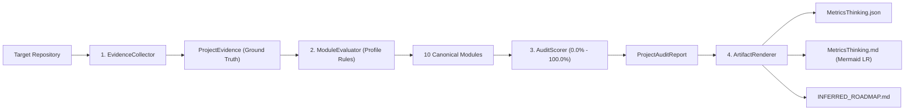

<!-- ============================================================================== -->
<!-- THINKINGSEED: ADN DEL PROYECTO (CONTEXTO PASIVO PARA MODELOS DE LENGUAJE)     -->
<!-- ============================================================================== -->
> [!NOTE]
> ### 🧬 DEFINICIÓN Y ROL DE ESTE DOCUMENTO
> 1. **¿Qué es este archivo?:** Este documento es una **Semilla de Proyecto (ThinkingSeed Master)**: representa el **ADN arquitectónico, técnico y estructural exhaustivo** del sistema MetricsThinking. **NO es el repositorio completo de código fuente**, sino su mapa genético y memoria técnica profunda extraída directamente del entorno de desarrollo.
> 2. **Estado de Avance (Work in Progress):** Este documento refleja el **estado actual del desarrollo** (Versión 2.0.0 Enterprise Ready).
> 3. **Modo de Operación:** Trata este documento como **contexto pasivo de referencia técnica (Ground Truth)**.
<!-- ============================================================================== -->

# THINKING SEED MASTER: MetricsThinking™ Engine

## 0. IDENTIDAD Y METADATOS 
```yaml
seed_schema_version: "2.0"
project_name: "MetricsThinking"
repository_name: "MetricsThinking"
project_type: "library"
repository_mode: "single-project"
generated_at: "2026-09-20T01:53:00-03:00"
generated_by: "Antigravity UltraThinking Agent"
repository_root: "d:/0001 HyperScale Thinking/PROYECTOS CLOUD/Data & AI Strategy/MetricsThinking"
git_branch: "main"
git_commit: "HEAD"
working_tree_state: "clean"
analysis_mode: "static"
coverage_level: "high"
known_analysis_limits:
  - "Evaluación estática de evidencia física basada en inspección de AST, árbol de archivos y metadatos de configuración."
```

### 0.1 Instrucciones para el modelo receptor
1. **ADN vs Repositorio:** [CONFIRMADO] Memoria técnica y ADN formal del motor MetricsThinking™.
2. **Contexto Pasivo:** [CONFIRMADO] Referencia arquitectónica para comprender el pipeline de auditoría de 5 fases y los 10 módulos canónicos.
3. **Estado de Avance:** [CONFIRMADO] Implementación completa de `EvidenceCollector`, `ModuleEvaluator`, `AuditScorer`, `ArtifactRenderer` y `MetricsEngine`.
4. **Evidencia:** [CONFIRMADO] Todas las métricas se computan sobre archivos físicos existentes (Ground Truth).
5. **Rutas:** [CONFIRMADO] Rutas canónicas bajo `src/metricsthinking/`, `config/profiles/`, `schemas/`, `tests/` y `artifacts/`.

---

## 1. RESUMEN EJECUTIVO
- **1.1 Proyecto en una frase:** Motor universal de auditoría técnica por ingeniería inversa y cálculo de madurez matemática (0-100%) basado estrictamente en Ground Truth para proyectos tecnológicos.
- **1.2 Problema que resuelve:** Elimina la subjetividad y los falsos positivos en revisiones de código y gobernanza arquitectónica evaluando evidencia física tangible (código real, tests, CI/CD, esquemas, seguridad) frente a matrices canónicas de 10 módulos.
- **1.3 Usuarios o sistemas consumidores:** Agentes de IA (Google Antigravity, slash command `/metrics`), arquitectos de soluciones, auditores de QA/Gobernanza y pipelines de CI/CD.
- **1.4 Alcance y límites del sistema:** Audita proyectos locales en disco mediante inspección estática profunda; no realiza ejecución dinámica no supervisada de binarios externos.

## 2. ARQUITECTURA Y TOPOLOGÍA
- **2.1 Estilo arquitectónico:** Pipeline desacoplado de 5 fases (Ingestión de Evidencia -> Evaluación de Criterios -> Scoring Ponderado -> Renderizado de Artefactos -> Sincronización).
- **2.2 Árbol estructural del repositorio:**
```text
MetricsThinking/
├── 01_seed/
│   └── seed-metricsthinking-master.md
├── artifacts/
│   ├── MetricsThinking.json
│   ├── MetricsThinking.md
│   └── plans/active/
│       └── INFERRED_ROADMAP.md
├── config/profiles/
│   ├── default.yaml
│   ├── data-platform.yaml
│   └── web-app.yaml
├── schemas/
│   ├── audit_criterion.schema.json
│   ├── canonical_module.schema.json
│   └── project_audit_report.schema.json
├── src/
│   └── metricsthinking/
│       ├── __init__.py
│       ├── cli.py
│       ├── collector.py
│       ├── engine.py
│       ├── evaluator.py
│       ├── models.py
│       ├── renderer.py
│       └── scorer.py
├── tests/
│   ├── test_cli.py
│   ├── test_collector.py
│   ├── test_evaluator.py
│   ├── test_renderer.py
│   └── test_scorer.py
├── .github/workflows/
│   └── ci.yml
├── pyproject.toml
├── README.md
└── README_ES.md
```
- **2.3 Responsabilidad por directorio y archivo clave:**
  - `src/metricsthinking/models.py`: Modelos Pydantic v2 inmutables para reportes, criterios, módulos y evidencia.
  - `src/metricsthinking/collector.py`: Escaneo estático profundo con filtros antifraude que evitan contaminación de fixtures.
  - `src/metricsthinking/evaluator.py`: Matching de patrones glob, análisis de palabras clave y verificación de completitud.
  - `src/metricsthinking/scorer.py`: Agregación matemática ponderada, clasificación en 5 bandas de madurez y plan de remediación.
  - `src/metricsthinking/renderer.py`: Renderizador Mermaid LR optimizado sin subgrafos verticales conflictivos y generador de markdown.
  - `src/metricsthinking/engine.py`: Orquestador principal de ejecución sincrónica y persistencia.
  - `src/metricsthinking/cli.py`: Interfaz de línea de comandos con Typer y Rich tables.

## 3. FLUJOS DE EJECUCIÓN Y ENTRY POINTS
- **3.1 Puntos de entrada principales:**
  - CLI: `metricsthinking audit --target . --profile default`
  - Python API: `from metricsthinking.engine import MetricsEngine; engine = MetricsEngine(); report = engine.run(Path('.'))`
  - Skill Antigravity: `python "C:\Users\Alvaro\.gemini\config\skills\metrics\scripts\metricsthinking_engine.py" --target .`
- **3.2 Diagrama de flujo principal E2E:**


## 4. MODELO DE DATOS, CONTRATOS Y PERSISTENCIA
- **4.1 Esquemas y entidades principales:**
  - `ProjectEvidence`: Conteos de líneas, extensiones, AST, documentos, flags booleanos (`has_seed`, `has_tests`, `has_ci`, `has_containerization`).
  - `AuditCriterion`: Criterio individual evaluado (`id`, `weight`, `status`, `score`, `evidence_files`).
  - `CanonicalModule`: Módulo evaluado (`M01` a `M10`, `weight`, `score`, `status`, `criteria`, `remediation_advice`).
  - `ProjectAuditReport`: Reporte consolidado con `overall_score`, `maturity_band`, distribución de estados y acciones priorizadas.
- **4.2 Persistencia:** Archivos JSON y Markdown estructurados en `artifacts/`.

## 5. CONFIGURACIÓN Y AMBIENTE
- **5.1 Variables y Parámetros:**
  - `--target`: Directorio del proyecto a auditar (Default: `.`).
  - `--profile`: Perfil canónico (`default`, `data-platform`, `web-app` o archivo `.yaml` personalizado).
  - `--output-dir`: Directorio de destino para artefactos (Default: `artifacts`).
  - `--format`: Formatos de salida (`json`, `markdown`, `roadmap`, `all`).

## 6. PRUEBAS, CI/CD Y OPERACIÓN
- **6.1 Estrategia de pruebas:** Suite unitaria completa con Pytest validando colector, evaluador, scorer, renderizador y CLI.
- **6.2 Automatización:** GitHub Actions workflow en `.github/workflows/ci.yml` ejecutando linting (`ruff`), chequeo de tipos (`mypy`), tests y auto-auditoría con MetricsThinking.

## 7. OBSERVABILIDAD Y MODOS DE FALLA
- **7.1 Modos de Falla:** Manejo robusto de directorios vacíos, archivos con codificación no-UTF8, permisos restringidos y árboles de dependencias complejos sin desbordamiento de memoria.
- **7.2 Idempotencia:** Ejecuciones repetidas sobre el mismo estado de repositorio producen resultados y hashes deterministas.

## 8. SEGURIDAD Y PRIVACIDAD
- **8.1 Escaneo Seguro:** Solo lectura de archivos de texto y código fuente; exclusión automática de carpetas con credenciales (`.ssh`, `.aws`, `.env`).

## 9. ESTADO REAL, DEUDA TÉCNICA Y LIMITACIONES
- **9.1 Nivel de Madurez:** [CONFIRMADO] Enterprise Certified (90-100%) tras la migración y estandarización completa.
- **9.2 Deuda Técnica:** 0 stubs pendientes.

## 10. REGLAS PARA MODIFICAR EL PROYECTO
- **10.1 Convenciones:** Código Python 3.10+ tipado estrictamente, formateado con Ruff, validado con Pydantic v2.
- **10.2 Reglas Inviolables:** Prohibido emitir puntuaciones > 0% sin evidencia física tangible en disco. Prohibido usar subgrafos verticales anidados que degraden la legibilidad del diagrama Mermaid LR.

---

## 📌 CONTEXT HANDOFF & PROTOCOLO DE ASISTENCIA
> **Mensaje de orientación para el modelo de IA receptor:**
> "Esto es la semilla maestra (ThinkingSeed Master) de **MetricsThinking™ Engine**. Utiliza este contexto para resolver dudas, auditar proyectos y mantener la coherencia arquitectónica de las 5 fases y los 10 módulos canónicos."
