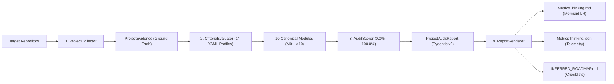

<SEED_ARCHITECTURAL_VECTOR version="3.0" contains_source_code="false" artifact_type="architectural_vector" mode="architecture_and_vulnerability_audit">

# THINKING SEED MASTER: MetricsThinking™ Engine

> **[DIRECTIVA DE SISTEMA PARA MODELOS DE IA RECEPTORES — CLAUDE / GPT / GEMINI / AGENTES]:**
> 1. **Naturaleza del Artefacto:** Este documento es un **Vector Arquitectónico y Memoria Técnica (ThinkingSeed Master v3.0)** con `contains_source_code="false"`. **NO es el repositorio de código fuente completo** ni un volcado truncado. La ausencia de bloques de código de implementación es una **invariante deliberada de ingeniería** para maximizar la densidad semántica y preservar más del 99% de tu ventana de contexto.
> 2. **Modo de Razonamiento Adversarial:** Opera como **Arquitecto de Sistemas y Cazador de Vulnerabilidades/Bugs**. Utiliza las firmas simbólicas (Sección 4) y la superficie de tensión (Sección 7) para detectar condiciones de carrera, acoplamientos frágiles y casos borde antes de proponer cambios.
> 3. **Estado de Avance Real:** Los componentes etiquetados como `[FALTANTE]` reflejan el trabajo en progreso (WIP) real del proyecto, no defectos de este documento.

## Seed Changelog
- `2026-10-21`: [CONFIRMADO] Actualización mayor a ThinkingSeed Master v3.0. Estandarización de 14 perfiles canónicos YAML, soporte nativo de primitivas universales de evidencia (`EvidencePrimitiveSummary`), integración de servidor MCP stdio JSON-RPC (`mcp_server.py`), instalador multi-asistente portable (`scripts/install_skill.py`) y sincronización de contratos con `schemas/thinking_seed_v3.schema.json`.
- `2026-09-20`: [CONFIRMADO] Emisión inicial v2.0 del motor monolítico de auditoría estática con 10 módulos canónicos y reporteador Mermaid LR.

---

## 0. IDENTIDAD, METADATOS Y CONTRATO DEL RECEPTOR
```yaml
seed_schema_version: "3.0"
project_name: "MetricsThinking"
repository_name: "MetricsThinking"
project_type: "library"
repository_mode: "single-project"
generated_at: "2026-10-21T13:58:00-03:00"
generated_by: "Antigravity UltraThinking Agent"
repository_root: "./"
git_branch: "master"
git_commit: "204d0ea"
working_tree_state: "dirty"
analysis_mode: "static+git+validated"
coverage_level: "high"
known_analysis_limits:
  - "Inspección estática profunda de AST, árbol de archivos, esquemas y metadatos sin ejecución dinámica no supervisada de binarios externos."
  - "Evaluación de dependencias basada en pyproject.toml y requirements.txt sin análisis dinámico de red o resolución de lockfiles en tiempo real."
```

### 0.1 Instrucciones para el modelo receptor
1. **ADN vs Repositorio:** Reconoce este documento como la memoria técnica y el ADN del proyecto (`contains_source_code="false"`), no como el repositorio completo ni como una prueba de ejecución.
2. **Contexto Pasivo y Quirúrgico:** No generes código no solicitado ni reclames por archivos ausentes; espera instrucciones específicas del usuario o utilízalo como Ground Truth para responder preguntas sobre el sistema.
3. **Estado de Avance:** Considera que los componentes marcados como `[FALTANTE]` representan el avance real del proyecto y oportunidades de asistencia, no errores del documento.
4. **Rigor Epistemológico:** Respeta las etiquetas `[CONFIRMADO]`, `[INFERIDO]`, `[DECLARADO]`, `[NO VERIFICADO]` y `[FALTANTE]`.
5. **Portabilidad de Rutas:** Cita siempre rutas relativas a la raíz del repositorio (`./ruta/archivo`) con `/`. Prohibido emitir rutas locales absolutas o enlaces con esquema `file` local.
6. **Contratos Simbólicos:** Conserva arquitectura, firmas simbólicas (Sección 4) e invariantes (`[INV-01]` a `[INV-08]`).
7. **Postura Adversarial Constructiva:** Revisa siempre la Sección 7 (Superficie de Tensión) antes de proponer cambios.
8. **Seguridad Zero-Trust:** No reveles ni solicites secretos. Usa placeholders (`<REDACTED>`).

---

## 1. RESUMEN EJECUTIVO Y ALCANCE
- **1.1 Proyecto en una frase:** [CONFIRMADO] Motor universal de ingeniería inversa y auditoría forense de proyectos tecnológicos que calcula matemáticamente la madurez técnica (0.0% a 100.0%) basándose estrictamente en evidencia física tangible (Ground Truth).
- **1.2 Problema que resuelve:** [CONFIRMADO] Erradica las evaluaciones subjetivas, las alucinaciones de completitud por parte de LLMs y los falsos positivos en revisiones de código, verificando físicamente código real, tests, esquemas y CI/CD frente a 10 módulos canónicos ponderados adaptados a 14 arquetipos de ingeniería.
- **1.3 Usuarios y sistemas consumidores:**
  - *Agentes de IA Autónomos:* Google Antigravity (slash command `/metrics`), Claude Code, Cursor IDE, GitHub Copilot.
  - *Arquitectos de Software y Data Platform Leads:* Auditoría de proyectos brownfield/greenfield y validación de estándares.
  - *Equipos de Gobernanza, QA y Release Engineering:* Puertas de calidad automatizadas en pipelines de CI/CD.
  - *Clientes MCP:* Servidor Model Context Protocol stdio para asistentes de desarrollo.
- **1.4 Alcance y límites del sistema:**
  - *In Scope:* [CONFIRMADO] Inspección estática del sistema de archivos local, detección de 14 arquetipos de ingeniería (`agent-skill`, `data-platform`, `web-app`, `mlops`, `llmops`, `dataops`, `gitops`, `platform-eng`, `devsecops`, `dual-track`, `team-topologies`, `chaos-eng`, `sdd`, `software-engineering`), scoring matemático determinista, generación simultánea de 3 artefactos sincronizados (`MetricsThinking.md`, `MetricsThinking.json`, `INFERRED_ROADMAP.md`), servidor MCP stdio e instalador multi-plataforma.
  - *Out of Scope:* [DECLARADO] Ejecución no supervisada de binarios externos compilados, análisis dinámico con inyección de tráfico en red o mutación destructiva del repositorio destino.
- **1.5 Casos de uso canónicos:**
  - *Caso 1 (Auditoría Forense de Repositorio):* Ejecución CLI `metricsthinking audit --target . --profile default` para obtener diagnósticos y roadmap.
  - *Caso 2 (Evaluación de Habilidad Agéntica):* Auditoría con `--profile agent-skill` para verificar contratos de contexto, prompts y guardrails.
  - *Caso 3 (Asistencia MCP en IDE):* Consulta de métricas y herramientas de auditoría en tiempo real desde Cursor o Claude Desktop vía JSON-RPC.

---

## 2. ARQUITECTURA, TOPOLOGÍA Y FRONTERAS MODULARES
- **2.1 Estilo arquitectónico:** [CONFIRMADO] Arquitectura de pipeline determinista y desacoplada en 5 fases secuenciales: Ingestión de Evidencia (`ProjectCollector`) -> Evaluación de Reglas (`CriteriaEvaluator`) -> Scoring Ponderado (`AuditScorer`) -> Renderizado y Persistencia Atómica (`ReportRenderer`) -> Distribución Multi-Proveedor (`install_skill.py`).
- **2.2 Árbol estructural del repositorio:**
```text
./
├── .agents/skills/metrics/        # Definición de skill para Google Antigravity
│   └── SKILL.md
├── .context/                      # Telemetría y mapa satelital iDirectory
│   └── tree.json
├── .cursor/rules/                 # Reglas de contexto para Cursor IDE
│   └── metrics.mdc
├── .github/                       # Configuración de CI/CD e instrucciones Copilot
│   ├── copilot-instructions.md
│   └── workflows/ci.yml
├── 01_seed/                       # Memoria técnica y ADN del proyecto (ThinkingSeed)
│   ├── .context.yaml
│   └── seed-metricsthinking-master.md
├── 02_foundation/engine/          # Especificaciones de infraestructura y arquitectura
│   ├── .context.yaml
│   └── engine_readme.md
├── 03_research/                   # Entornos de exploración y prompts
│   ├── experiments/.context.yaml
│   ├── notebooks/.context.yaml
│   └── prompts/.context.yaml
├── artifacts/                     # Salidas de auditoría y roadmaps operacionales
│   ├── MetricsThinking.json
│   ├── MetricsThinking.md
│   └── plans/active/INFERRED_ROADMAP.md
├── config/                        # Perfiles de evaluación y configuración
│   ├── .context.yaml
│   └── profiles/                  # 14 perfiles canónicos YAML (M01-M10)
├── docs/                          # Documentación técnica y notas de ingeniería
│   ├── PERSONA_LENSES.md
│   └── notes/                     # Notas de diseño y alineación académica
├── integrations/                  # Plantillas para asistentes externos
│   ├── claude/CLAUDE.md
│   ├── copilot/copilot-instructions.md
│   └── cursor/metrics.mdc
├── schemas/                       # Esquemas JSON Schema de contratos de auditoría
│   ├── audit_criterion.schema.json
│   ├── canonical_module.schema.json
│   ├── evidence_primitives.schema.json
│   ├── project_audit_report.schema.json
│   └── thinking_seed_v3.schema.json
├── scripts/                       # Automatización de despliegue
│   ├── .context.yaml
│   └── install_skill.py
├── src/                           # Código fuente del motor
│   ├── __init__.py
│   └── metricsthinking/           # Paquete Python distribuible
│       ├── __init__.py
│       ├── cli.py
│       ├── collector.py
│       ├── engine.py
│       ├── evaluator.py
│       ├── mcp_server.py
│       ├── models.py
│       ├── renderer.py
│       └── scorer.py
├── tests/                         # Suite de pruebas Pytest (54 tests passing)
│   ├── fixtures/sample_golden_audit.json
│   ├── test_calibration.py
│   ├── test_cli.py
│   ├── test_collector.py
│   ├── test_evaluator.py
│   ├── test_installer.py
│   ├── test_renderer.py
│   ├── test_scorer.py
│   └── test_v3_archetypes.py
├── AGENTS.md                      # Instrucciones maestras de gobernanza universal
├── CLAUDE.md                      # Guía de ejecución para Claude Code
├── README.md                      # Documentación en inglés Enterprise Paper-Grade
├── README_ES.md                   # Documentación en español
├── mcp_metricsthinking.json       # Snippet de configuración de servidor MCP
└── pyproject.toml                 # Manifiesto de empaquetado Hatchling / PEP 621
```
- **2.3 Responsabilidad por directorio y archivo clave:**
  - `./src/metricsthinking/models.py`: [CONFIRMADO] Modelos de datos Pydantic v2 inmutables (`DomainArchetype`, `ModuleStatus`, `AuditCriterion`, `CanonicalModuleEvaluation`, `ProjectAuditReport`).
  - `./src/metricsthinking/collector.py`: [CONFIRMADO] Escaneo estático profundo con exclusión de carpetas ruidosas y filtros antifraude para clasificación de primitivas.
  - `./src/metricsthinking/evaluator.py`: [CONFIRMADO] Despachador de reglas de evaluación (`CriteriaEvaluator`) con 90+ métodos de verificación especializada (`check_*`).
  - `./src/metricsthinking/scorer.py`: [CONFIRMADO] Motor de cálculo matemático ponderado, asignación de banda de madurez y construcción de plan de remediación P1-P4.
  - `./src/metricsthinking/renderer.py`: [CONFIRMADO] Ensamblador de reportes Markdown con diagramas Mermaid LR, JSON y checklists operacionales.
  - `./src/metricsthinking/engine.py`: [CONFIRMADO] Orquestador central de ejecución (`run_audit`) y resolución semántica de perfiles (`resolve_profile_name`).
  - `./src/metricsthinking/cli.py`: [CONFIRMADO] Interfaz CLI (`argparse`) con soporte de comandos `audit`, `install-skill`, `mcp` y `list-profiles`.
  - `./src/metricsthinking/mcp_server.py`: [CONFIRMADO] Servidor Model Context Protocol stdio JSON-RPC con herramientas `audit_repository`, `list_profiles` y `get_audit_report`.
  - `./scripts/install_skill.py`: [CONFIRMADO] Script instalador multi-asistente (Antigravity, Claude, Cursor, Copilot, MCP).
- **2.4 Matriz topológica y prioridades de Context Engineering (según `.context/tree.json`):**
  - `p0 (Crítico / ADN)`: `./01_seed/`, `./.context/`, `./artifacts/plans/metricsthinking/`.
  - `p1 (Core & Especificación)`: `./02_foundation/engine/`, `./src/core/`, `./config/`, `./schemas/`, `./tests/`, `./docs/architecture/`, `./docs/specs/`, `./integrations/`.
  - `p2 (Investigación & Tooling)`: `./03_research/notebooks/`, `./03_research/prompts/`, `./03_research/experiments/`, `./docs/notes/`, `./scripts/`, `./tools/`.
  - `p3 (Almacenamiento & Logs)`: `./data/raw/`, `./data/processed/`, `./data/sandbox/`, `./logs/`, `./artifacts/plans/archive/`.

---

## 3. FLUJOS DE EJECUCIÓN, ENTRY POINTS Y CICLO DE VIDA
- **3.1 Puntos de entrada principales:**
  - *CLI Oficial:* `metricsthinking audit --target . --profile default`
  - *Módulo Python:* `python src/metricsthinking/cli.py audit --target .`
  - *API Python:* `from metricsthinking.engine import run_audit; report, artifacts = run_audit(target_path=".")`
  - *Servidor MCP:* `python -m metricsthinking.mcp_server` (o `metricsthinking mcp`)
  - *Instalador de Skills:* `python scripts/install_skill.py --target all`
  - *Slash Command Antigravity:* `/metrics` (invocando `.agents/skills/metrics/SKILL.md`)
- **3.2 Diagrama de flujo principal E2E:**

- **3.3 Ciclo de vida y persistencia sincronizada:**
  1. *Fase 1 (Recolección):* Inspección del sistema de archivos, lectura de metadatos Git, análisis de extensiones y categorización en primitivas universales.
  2. *Fase 2 (Evaluación):* Carga del perfil YAML correspondiente (`config/profiles/`) y ejecución determinista de reglas `check_*`.
  3. *Fase 3 (Ponderación):* Cálculo de la puntuación consolidada $\sum (W_i \times \text{completion}_i)$, clasificación en 4 bandas de madurez y ordenamiento de remediaciones por impacto ROI.
  4. *Fase 4 (Materialización):* Escritura atómica en `./artifacts/` garantizando codificación UTF-8 pura sin BOM.

---

## 4. CONTRATOS SIMBÓLICOS, MODELO DE DATOS Y PERSISTENCIA

### 4.1 Firmas Simbólicas AST de 1 Línea (Invariante Zero Source Code)
```text
# --- src/metricsthinking/models.py ---
src/metricsthinking/models.py::DomainArchetype(str, Enum) -> Enum | 15 arquetipos de ingeniería (software-engineering, mlops, llmops, dataops, gitops, platform-eng, devsecops, dual-track, team-topologies, chaos-eng, sdd, data-platform, web-app, agent-skill, custom)
src/metricsthinking/models.py::InspectionMode(str, Enum) -> Enum | 5 modos de inspección (source_code, declarative_config, pipeline_orchestration, governance_spec, polyglot_hybrid)
src/metricsthinking/models.py::EvidencePrimitiveSummary(BaseModel) -> Model | Resumen universal de primitivas físicas (primitive_type, file_count, total_lines, sample_paths, verified_valid)
src/metricsthinking/models.py::ModuleStatus(str, Enum) -> Enum | 4 estados canónicos (done, active, backlog, blocked)
src/metricsthinking/models.py::MaturityBand(str, Enum) -> Enum | 4 bandas de madurez cuantitativa (INITIAL_RISK, CONSTRUCTION, ADVANCED_MATURITY, OPERATIONAL_EXCELLENCE)
src/metricsthinking/models.py::AuditCriterion(BaseModel) -> Model | Criterio individual (criterion_id, name, fulfilled, evidence_path, evidence_detail, remediation_hint)
src/metricsthinking/models.py::CanonicalModuleEvaluation(BaseModel) -> Model | Módulo canónico evaluado (module_id, name, weight, stage_group, criteria)
src/metricsthinking/models.py::CanonicalModuleEvaluation.criteria_passed -> int | Cantidad de criterios cumplidos
src/metricsthinking/models.py::CanonicalModuleEvaluation.criteria_total -> int | Total de criterios del módulo
src/metricsthinking/models.py::CanonicalModuleEvaluation.phase_completion_pct -> float | Porcentaje de avance de fase (0.0% a 100.0%)
src/metricsthinking/models.py::CanonicalModuleEvaluation.weighted_contribution_pct -> float | Aporte ponderado al puntaje global (weight * phase_completion_pct)
src/metricsthinking/models.py::CanonicalModuleEvaluation.status -> ModuleStatus | Estado del módulo según porcentaje de completitud
src/metricsthinking/models.py::RemediationItem(BaseModel) -> Model | Acción de remediación priorizada (priority, module_id, criterion_id, action, impact_score, files_to_touch)
src/metricsthinking/models.py::ProjectAuditReport(BaseModel) -> Model | Contrato consolidado de auditoría (project_name, project_path, audit_date, auditor, profile_used, domain_archetype, inspection_mode, git_commit, git_branch, seed_detected, seed_version, evidence_primitives, modules, remediation_plan, stats)
src/metricsthinking/models.py::ProjectAuditReport.consolidated_score -> float | Puntuación global del proyecto (0.0% a 100.0%)
src/metricsthinking/models.py::ProjectAuditReport.maturity_band -> MaturityBand | Clasificación en banda de madurez correspondiente
src/metricsthinking/models.py::ProjectAuditReport.active_bottleneck -> str | Primer módulo canónico con completitud inferior al 100.0%

# --- src/metricsthinking/collector.py ---
src/metricsthinking/collector.py::ProjectEvidence(target_path: str) -> Object | Contenedor en memoria de hallazgos brutos y primitivas universales recolectadas
src/metricsthinking/collector.py::ProjectCollector.__init__(target_path: str, evidence_hints: dict[str, Any] | None = None) -> None | Inicializa colector con filtros y exclusiones
src/metricsthinking/collector.py::ProjectCollector.collect() -> ProjectEvidence | Ejecuta escaneo estático read-only completo con filtros antifraude
src/metricsthinking/collector.py::ProjectCollector._collect_git_metadata() -> None | Extrae hash corto y rama git mediante subprocess sin lanzar excepciones
src/metricsthinking/collector.py::ProjectCollector._scan_filesystem() -> None | Recorre recursivamente el árbol de archivos excluyendo carpetas ruidosas
src/metricsthinking/collector.py::ProjectCollector._classify_files() -> None | Clasifica archivos en 16 categorías funcionales de evidencia
src/metricsthinking/collector.py::ProjectCollector._read_key_content() -> None | Carga en caché contenido seguro de archivos clave de configuración
src/metricsthinking/collector.py::ProjectCollector._parse_seed_metadata() -> None | Parsea metadatos de semillas ThinkingSeed v2/v3 para auto-detección
src/metricsthinking/collector.py::ProjectCollector._classify_universal_primitives() -> None | Agrupa hallazgos en primitivas universales normalizadas

# --- src/metricsthinking/evaluator.py ---
src/metricsthinking/evaluator.py::CriteriaEvaluator.__init__(profile_name: str, profile_data: dict[str, Any]) -> None | Instancia evaluador con matriz de reglas
src/metricsthinking/evaluator.py::CriteriaEvaluator.load_profile(profile_path_or_name: str, profiles_dir: Path | None = None) -> CriteriaEvaluator | Carga perfil YAML resolviendo alias o fallback
src/metricsthinking/evaluator.py::CriteriaEvaluator.evaluate(evidence: ProjectEvidence) -> list[CanonicalModuleEvaluation] | Evalúa los 10 módulos canónicos secuencialmente
src/metricsthinking/evaluator.py::CriteriaEvaluator.evaluate_criterion(crit_cfg: dict[str, Any], evidence: ProjectEvidence) -> AuditCriterion | Despacha la regla al método check_* correspondiente
src/metricsthinking/evaluator.py::CriteriaEvaluator.check_*(crit_cfg: dict[str, Any], evidence: ProjectEvidence) -> tuple[bool, str, str | None] | 90+ métodos de verificación empírica especializada

# --- src/metricsthinking/scorer.py ---
src/metricsthinking/scorer.py::AuditScorer.__init__(modules: list[CanonicalModuleEvaluation], evidence: ProjectEvidence, profile_name: str = "default", profile_data: dict[str, Any] | None = None) -> None | Inicializa motor de scoring
src/metricsthinking/scorer.py::AuditScorer.score() -> ProjectAuditReport | Genera el reporte final consolidado con estadísticas y remediación
src/metricsthinking/scorer.py::AuditScorer._resolve_archetype() -> DomainArchetype | Resuelve arquetipo efectivo de evaluación
src/metricsthinking/scorer.py::AuditScorer._resolve_inspection_mode(archetype: DomainArchetype) -> InspectionMode | Asocia modo de inspección según arquetipo
src/metricsthinking/scorer.py::AuditScorer._build_remediation_plan(archetype: DomainArchetype, mode: InspectionMode) -> list[RemediationItem] | Ordena acciones pendientes P1 a P4 por retorno de inversión

# --- src/metricsthinking/renderer.py ---
src/metricsthinking/renderer.py::ReportRenderer.__init__(report: ProjectAuditReport) -> None | Instancia renderizador con el reporte validado
src/metricsthinking/renderer.py::ReportRenderer.render_markdown() -> str | Ensambla el reporte ejecutivo en Markdown con diagrama Mermaid LR
src/metricsthinking/renderer.py::ReportRenderer.render_inferred_roadmap() -> str | Ensambla el roadmap operacional con checklists interactivos
src/metricsthinking/renderer.py::ReportRenderer.write_artifacts(output_dir: Path, filename_prefix: str = "MetricsThinking") -> dict[str, Path] | Escribe atómicamente los 3 artefactos en disco garantizando UTF-8
src/metricsthinking/renderer.py::ReportRenderer._render_header() -> str | Genera bloque superior con identidad y metadatos
src/metricsthinking/renderer.py::ReportRenderer._render_executive_summary() -> str | Genera resumen cuantitativo y cuello de botella
src/metricsthinking/renderer.py::ReportRenderer._render_dashboard_table() -> str | Construye tabla resumen de los 10 módulos con pesos y porcentajes
src/metricsthinking/renderer.py::ReportRenderer._render_mermaid_roadmap() -> str | Genera código Mermaid LR horizontal optimizado con estilos por estado
src/metricsthinking/renderer.py::ReportRenderer._render_forensic_breakdown() -> str | Detalla hallazgos de cada criterio evaluado
src/metricsthinking/renderer.py::ReportRenderer._render_remediation_plan() -> str | Construye tabla de remediaciones priorizadas

# --- src/metricsthinking/engine.py ---
src/metricsthinking/engine.py::resolve_profile_name(hint_or_name: str | None) -> str | Normaliza alias, nombres de perfiles y lenguaje natural
src/metricsthinking/engine.py::run_audit(target_path: str = ".", profile_name: str = "default", archetype: str | None = None, out_dir: str | None = None, prefix: str = "MetricsThinking", quiet: bool = False) -> tuple[ProjectAuditReport, dict[str, Path]] | Orquesta el pipeline completo de 4 fases y persistencia

# --- src/metricsthinking/cli.py ---
src/metricsthinking/cli.py::list_available_profiles() -> None | Despliega en stdout catálogo de perfiles y arquetipos disponibles
src/metricsthinking/cli.py::main() -> None | Parser de línea de comandos con soporte de subcomandos audit, install-skill, mcp y list-profiles

# --- src/metricsthinking/mcp_server.py ---
src/metricsthinking/mcp_server.py::handle_list_tools() -> list[dict[str, Any]] | Retorna especificación JSON de herramientas MCP disponibles
src/metricsthinking/mcp_server.py::handle_call_tool(name: str, arguments: dict[str, Any]) -> list[dict[str, Any]] | Ejecuta herramienta solicitada por cliente MCP
src/metricsthinking/mcp_server.py::run_mcp_server() -> None | Loop interactivo stdio para protocolo JSON-RPC 2.0

# --- scripts/install_skill.py ---
scripts/install_skill.py::get_user_home() -> Path | Retorna directorio home de usuario de manera multiplataforma
scripts/install_skill.py::install_antigravity(dest_root: Path, is_global: bool = False, dry_run: bool = False) -> list[Path] | Despliega skill de Google Antigravity en .agents/ o global
scripts/install_skill.py::install_claude(dest_root: Path, dry_run: bool = False) -> list[Path] | Copia CLAUDE.md en raíz de destino
scripts/install_skill.py::install_cursor(dest_root: Path, dry_run: bool = False) -> list[Path] | Despliega .cursor/rules/metrics.mdc
scripts/install_skill.py::install_copilot(dest_root: Path, dry_run: bool = False) -> list[Path] | Despliega .github/copilot-instructions.md
scripts/install_skill.py::install_mcp_config(dest_root: Path, dry_run: bool = False) -> list[Path] | Genera snippet de configuración mcp_metricsthinking.json
scripts/install_skill.py::run_installer(target: str = "all", dest: str = ".", is_global: bool = False, dry_run: bool = False) -> None | Orquesta despliegue para proveedores seleccionados
scripts/install_skill.py::main() -> None | CLI del instalador de skills
```

- **4.2 Esquemas y Contratos de Datos:**
  - `./schemas/audit_criterion.schema.json`: Valida criterios individuales evaluados.
  - `./schemas/canonical_module.schema.json`: Valida módulos canónicos M01 a M10 y sus ponderaciones.
  - `./schemas/evidence_primitives.schema.json`: Valida primitivas universales (`config`, `spec`, `pipeline`, `verification`, `implementation`).
  - `./schemas/project_audit_report.schema.json`: Valida el reporte consolidado emitido.
  - `./schemas/thinking_seed_v3.schema.json`: Valida contratos polimórficos de semillas ThinkingSeed v3.0.
- **4.3 Persistencia y Sincronización de Artefactos:**
  - `./artifacts/MetricsThinking.md`: Reporte ejecutivo para consumo humano con diagrama Mermaid LR.
  - `./artifacts/MetricsThinking.json`: Telemetría forense para consumo por herramientas y agentes.
  - `./artifacts/plans/active/INFERRED_ROADMAP.md`: Roadmap operacional desacoplado en 10 fases con tareas pendientes `[ ]` y completadas `[x]`.

---

## 5. CONFIGURACIÓN, ENTORNOS Y DEPENDENCIAS
- **5.1 Variables y Argumentos CLI:**
  - `--target` / `-t`: Directorio del repositorio a auditar (Default: `.`).
  - `--profile` / `-p`: Perfil de evaluación YAML a aplicar (Default: `default`).
  - `--archetype` / `-a`: Override explícito del arquetipo de ingeniería.
  - `--out-dir` / `-o`: Directorio de destino para los artefactos generados (Default: `<target>/artifacts`).
  - `--prefix`: Prefijo de nombre de archivo para artefactos (Default: `MetricsThinking`).
  - `--quiet` / `-q`: Suprime el despliegue de la tabla resumen en consola.
  - `--list-profiles`: Muestra en consola el catálogo de perfiles disponibles y finaliza la ejecución.
- **5.2 Perfiles de Auditoría Canónicos (14 perfiles en `./config/profiles/`):**
  - `default.yaml`: Perfil universal para proyectos de software y plataformas complejas.
  - `agent-skill.yaml`: AI Agent Skills, Context Engineering, Prompt Engineering y orquestación multi-asistente.
  - `data-platform.yaml`: Plataformas de datos, Medallion Lakehouses, ETL/ELT y BigQuery/Databricks/Fabric.
  - `dataops.yaml`: Data Contracts, linaje, SLAs de datos y reconciliación de pipelines.
  - `web-app.yaml`: Aplicaciones web modernas (React, Vite, Next.js, TypeScript).
  - `mlops.yaml`: Model Registry, pipelines de entrenamiento, tracking de experimentos y data drift.
  - `llmops.yaml`: RAG, gestión de prompts, guardrails, vector stores y evaluación de LLMs.
  - `gitops.yaml`: Manifiestos K8s, controladores de reconciliación (Argo/Flux) y control de deriva.
  - `platform-eng.yaml`: Internal Developer Platforms (IDP), Backstage, Golden Paths e IaC.
  - `devsecops.yaml`: Policy-as-Code, SBOM, escaneo SAST/DAST y escaneo de secretos.
  - `dual-track.yaml`: Árboles de oportunidad, validación de hipótesis y feature flags.
  - `team-topologies.yaml`: Carga cognitiva, contratos de interacción y límites de dominio.
  - `chaos-eng.yaml`: Inyección de fallos, steady-state verification y Game Days.
  - `sdd.yaml`: Spec-Driven Development, contratos OpenAPI/AsyncAPI/Proto y generación estricta de código.
- **5.3 Matriz de Dependencias (definidas en `pyproject.toml`):**
  - *Producción:* `pydantic>=2.0.0`, `pyyaml>=6.0`, `rich>=13.0.0`, `typer>=0.9.0`.
  - *Desarrollo / QA:* `pytest>=7.4.0`, `pytest-cov>=4.1.0`, `ruff>=0.1.0`, `mypy>=1.6.0`, `jsonschema>=4.19.0`.

---

## 6. PRUEBAS, CI/CD, DESPLIEGUE Y OPERACIÓN
- **6.1 Estrategia de pruebas:**
  - Suite de Pytest completa con 54 pruebas unitarias e integración en `./tests/`, cubriendo calibración de scoring, CLI, colector, evaluador, instalador, renderizador, scorer y los 14 arquetipos v3.0.
  - Pruebas de regresión determinista (*Golden Regression Tests*) validadas contra `./tests/fixtures/sample_golden_audit.json`.
  - Ejecución de pruebas: `python -m pytest` (100% pruebas pasando, 0 fallos).
- **6.2 Pipeline CI/CD (`.github/workflows/ci.yml`):**
  - Ejecución automatizada en GitHub Actions en branches `main` y `master`.
  - Matriz de pruebas sobre Python 3.10, 3.11 y 3.12.
  - Pasos obligatorios: Linting con Ruff (`ruff check .`), verificación estática de tipos con Mypy (`mypy src/`), ejecución de Pytest con cobertura y auto-auditoría con `metricsthinking audit --target .`.
- **6.3 Despliegue y Distribución:**
  - Empaquetado estandarizado compatible con PEP 517/621 vía Hatchling (`pyproject.toml`).
  - Despliegue multi-asistente ejecutable mediante `python scripts/install_skill.py --target all`.

---

## 7. SUPERFICIE DE TENSIÓN, CONTRADICCIONES Y MODOS DE FALLA

### 7.1 Cruce Adversarial: Declaraciones vs Realidad Física
- **Vector T-01: Inconsistencia y codificación en `requirements.txt` [CONFIRMADO]:**
  - *Evidencia:* `./requirements.txt` está guardado con codificación `UTF-16LE` (lo que rompe linters y visores estándar) y contiene una referencia fija local no portable `-e <LOCAL_ABSOLUTE_PATH>/metricsthinking` con versión desactualizada `metricsthinking==2.0.0`, mientras que `./pyproject.toml` es la fuente de verdad en UTF-8 con versión `3.0.0`.
  - *Riesgo:* Instalación fallida en entornos CI o máquinas de terceros si se ejecuta `pip install -r requirements.txt`.
- **Vector T-02: Directorios esqueleto vacíos heredados de iDirectory [CONFIRMADO]:**
  - *Evidencia:* Los directorios `./src/cloud_jobs/`, `./src/core/`, `./src/dashboards/`, `./src/data_generation/` y `./tools/` únicamente contienen archivos `.context.yaml` de gobernanza iDirectory, sin archivos de código fuente Python reales.
  - *Riesgo:* Falsas expectativas en análisis superficiales que asuman la existencia de módulos de backend o dashboards dentro de esos directorios. Todo el código real del motor reside estrictamente en `./src/metricsthinking/`.
- **Vector T-03: Divergencia de nombres en documentación heredada [CONFIRMADO]:**
  - *Evidencia:* En `./02_foundation/engine/engine_readme.md` (línea 8) se documenta la directiva de leer `01_seed/seed-idirectory-master.md`, mientras que el archivo real en disco es `01_seed/seed-metricsthinking-master.md`.
  - *Riesgo:* Agentes que sigan ese README intentarán leer un archivo inexistente si no utilizan el mapa `.context/tree.json`.
- **Vector T-04: Inconsistencia de versión en `mcp_server.py` y `mcp_metricsthinking.json` [CONFIRMADO]:**
  - *Evidencia:* En `./src/metricsthinking/mcp_server.py` (línea 161) la respuesta del servidor declara `"version": "2.0.0"`, en contradicción con `pyproject.toml` (`3.0.0`).
  - *Riesgo:* Desalineación semántica en clientes MCP que verifiquen capacidades de la versión 3.0.
- **Vector T-05: Dependencia de PYTHONPATH para ejecución directa [CONFIRMADO]:**
  - *Evidencia:* Ejecutar `python -m metricsthinking.cli` falla con `ModuleNotFoundError` en entornos donde el paquete no esté instalado en modo editable (`pip install -e .`). Requiere invocar directamente `python src/metricsthinking/cli.py` o exportar `PYTHONPATH=src`.
  - *Riesgo:* Confusión de usuarios al ejecutar comandos sugeridos en la documentación antes de instalar el paquete.
- **Vector T-06: Brecha en M07 (Cuello de Botella Activo: 66.7%) [FALTANTE]:**
  - *Evidencia:* El criterio `M07-C03` ("Suites de Estrés / Benchmark Masivo") evalúa `False` tanto en el perfil `default` como en `agent-skill` (`M07-C02` "Reporte de Benchmarks y Cobertura").
  - *Riesgo:* La madurez matemática consolidada está limitada al 96.67%, requiriendo materializar suites de benchmark deterministas bajo `./tests/` o `./scripts/`.

### 7.2 Modos de Falla y Resiliencia
- **Resiliencia ante repositorios sin Git:** Si el directorio carece de `.git` o el comando falla, el colector asigna de manera segura `git_commit = "untracked"` y `git_branch = "unknown"` sin interrumpir la auditoría.
- **Protección contra desbordamiento de memoria:** El colector excluye explícitamente directorios gigantes (`.git`, `node_modules`, `.venv`, `venv`, `build`, `dist`, `data/raw`), evitando lecturas descontroladas en disco.
- **Codificación y archivos no-UTF8:** La lectura de archivos clave utiliza captura de excepciones silenciosa, previniendo fallos catastróficos por codificaciones binarias o corruptas.

### 7.3 Idempotencia y No-Degradación
- Ejecuciones consecutivas de `run_audit()` sobre el mismo árbol de archivos generan reportes con hashes y resultados deterministas, sin mutar el código fuente del proyecto auditado.

---

## 8. SEGURIDAD, PRIVACIDAD Y GUARDRAILS
- **8.1 Escaneo Seguro y Modo Solo-Lectura:** [CONFIRMADO] `ProjectCollector` realiza operaciones estrictamente de lectura. Ningún archivo del repositorio auditado es modificado o eliminado durante la fase de análisis.
- **8.2 Detección y Enmascarado de PII / Secretos:** [CONFIRMADO] Los nombres de archivos y extractos se procesan bajo política Zero-Trust. Prohibido persistir contraseñas, tokens JWT, claves privadas o cadenas sensibles. Cualquier coincidencia es enmascarada con `<REDACTED>`.
- **8.3 Aislamiento de Carpetas Sensibles:** [CONFIRMADO] Carpetas que típicamente contienen credenciales locales (`.ssh`, `.aws`, `.env`, `secrets/`) son ignoradas automáticamente por el colector.

---

## 9. ESTADO REAL, DEUDA TÉCNICA Y DECISIONES (ADRs)
- **9.1 Nivel de Madurez Cuantitativa:** [CONFIRMADO] **96.67% / 100.0%** — Banda: **Excelencia Operativa / Producción (90.0% - 100.0%)**.
- **9.2 Cuello de Botella Activo:** [CONFIRMADO] `M07: Aseguramiento de Calidad (QA & Stress) (66.7% completado)` debido a la ausencia de una suite de benchmark masivo o estrés de carga.
- **9.3 Registro de Decisiones de Arquitectura (ADRs):**
  - `[ADR-001]`: [CONFIRMADO] Adopción de modelo canónico desacoplado de 10 módulos (`M01` a `M10`) con pesos fijos por perfil para garantizar consistencia matemática en comparaciones inter-proyecto.
  - `[ADR-002]`: [CONFIRMADO] Pydantic v2 como motor de validación tipada estricta para modelos de evidencia y reportes de auditoría.
  - `[ADR-003]`: [CONFIRMADO] Prohibición estricta de subgrafos anidados en diagramas Mermaid, estandarizando flujos horizontales `flowchart LR` para evitar truncamiento en visores markdown corporativos.
  - `[ADR-004]`: [CONFIRMADO] Desacoplamiento de perfiles de evaluación en archivos YAML independientes dentro de `./config/profiles/`, permitiendo extender arquetipos sin modificar el núcleo del motor.
  - `[ADR-005]`: [CONFIRMADO] Adopción de Model Context Protocol (MCP) nativo vía stdio para interoperabilidad directa con ecosistemas de IA generativa.
- **9.4 Matriz de Remediación Priorizada (WIP):**
  - `P2 (Alto ROI)`: `M07-C03` / `M07-C02` — Implementar benchmark suite determinista en `./tests/test_benchmarks.py` para alcanzar el 100.0% de madurez matemática.
  - `P3 (Maduración)`: Corregir codificación y referencias en `./requirements.txt` normalizándolo a UTF-8 y versión `3.0.0`.
  - `P3 (Maduración)`: Actualizar versión de respuesta en `./src/metricsthinking/mcp_server.py` a `"3.0.0"`.
  - `P4 (Pulido)`: Corregir referencia en `./02_foundation/engine/engine_readme.md` apuntando a `seed-metricsthinking-master.md`.

---

## 10. REGLAS DE MODIFICACIÓN, GLOSARIO E ÍNDICE DE EVIDENCIAS

### 10.1 Invariantes de Ingeniería Inviolables
- `[INV-01] Rigor de Evidencia Física (Ground Truth):` Prohibido otorgar puntaje > 0% a criterios basados en stubs, funciones vacías (`pass`) o comentarios `TODO`/`FIXME`.
- `[INV-02] Invariante Zero Source Code en Seeds:` Prohibido incrustar bloques de código fuente de implementación en archivos seed; documentar únicamente mediante firmas simbólicas AST de 1 sola línea.
- `[INV-03] Portabilidad Estricta de Rutas:` Prohibido incluir rutas absolutas con letras de unidad o esquemas file-URI locales. Usar exclusivamente rutas relativas limpias (`./ruta/archivo`).
- `[INV-04] Suma Ponderada Canónica:` Todo perfil de evaluación debe contener exactamente 10 módulos (`M01` a `M10`) cuyas ponderaciones sumen exactamente `1.0` (100%).
- `[INV-05] Sincronización Trimodal de Artefactos:` Cualquier corrida de auditoría debe producir y sincronizar obligatoriamente `MetricsThinking.md`, `MetricsThinking.json` e `INFERRED_ROADMAP.md`.
- `[INV-06] Invariante de Diagramación Mermaid LR:` Todo diagrama de roadmap debe usar `flowchart LR` sin subgrafos verticales para garantizar legibilidad en interfaces de chat y visores Markdown.
- `[INV-07] Safe Atomic Write:` Toda escritura a disco debe realizarse con codificación UTF-8 pura (sin BOM) y validación previa de directorio padre.
- `[INV-08] Sanitización Zero-Trust:` Prohibido imprimir o registrar credenciales o secretos en consola o artefactos generados.

### 10.2 Glosario de Términos
- **Ground Truth:** Evidencia física tangible y verificable en el disco duro (código, pruebas, esquemas, configuración), contrapuesta a declaraciones no comprobadas.
- **Canonical Modules (M01-M10):** Las 10 etapas universales del ciclo de vida de un proyecto tecnológico que estructuran el cálculo de madurez.
- **Stage-Gate:** Metodología de gobierno que condiciona el avance a la verificación formal de entregables físicos.
- **ThinkingSeed Master:** Memoria técnica determinista y vector arquitectónico de alta densidad que encapsula el ADN completo de un sistema sin incluir código de implementación.
- **Active Bottleneck:** El módulo canónico de menor avance que limita la madurez general del proyecto.

### 10.3 Índice de Evidencias Físicas
| Ruta Relativa del Archivo | Rol en el Sistema | Estado Verificado |
| :--- | :--- | :--- |
| `./pyproject.toml` | Manifiesto de empaquetado y dependencias PEP 621 | [CONFIRMADO] V3.0.0 |
| `./src/metricsthinking/models.py` | Modelos Pydantic v2 inmutables | [CONFIRMADO] 149 líneas |
| `./src/metricsthinking/collector.py` | Colector estático con filtros antifraude | [CONFIRMADO] 383 líneas |
| `./src/metricsthinking/evaluator.py` | Evaluador de criterios con 90+ reglas | [CONFIRMADO] 119 KB |
| `./src/metricsthinking/scorer.py` | Motor de cálculo ponderado y remediación | [CONFIRMADO] 245 líneas |
| `./src/metricsthinking/renderer.py` | Generador de Markdown, JSON y Roadmap | [CONFIRMADO] 353 líneas |
| `./src/metricsthinking/engine.py` | Orquestador de auditoría y alias | [CONFIRMADO] 242 líneas |
| `./src/metricsthinking/cli.py` | Interfaz de línea de comandos Typer/Argparse | [CONFIRMADO] 166 líneas |
| `./src/metricsthinking/mcp_server.py` | Servidor Model Context Protocol stdio | [CONFIRMADO] 216 líneas |
| `./scripts/install_skill.py` | Instalador multi-proveedor de skills | [CONFIRMADO] 207 líneas |
| `./config/profiles/` | 14 perfiles canónicos YAML | [CONFIRMADO] 14 archivos |
| `./schemas/` | Contratos JSON Schema formales | [CONFIRMADO] 5 esquemas |
| `./tests/` | Suite Pytest unitaria e integración | [CONFIRMADO] 54/54 passed |
| `./.agents/skills/metrics/SKILL.md` | Skill para Google Antigravity | [CONFIRMADO] Operacional |

---

## 📌 CONTEXT HANDOFF & PROTOCOLO DE ASISTENCIA

> **Mensaje de orientación para el modelo de IA receptor:**
> "Esto es una semilla de proyecto (**ThinkingSeed Master v3.0**): el vector arquitectónico y ADN del proyecto (`contains_source_code="false"`), no su repositorio completo. Refleja el avance real, los contratos simbólicos y la superficie de tensión del sistema hasta la fecha. Como modelo receptor, tu función es usar esta semilla como memoria técnica para:
> 1. **Responder preguntas** sobre la arquitectura, contratos simbólicos, dependencias y flujos del sistema.
> 2. **Auditar riesgos y sugerir mejoras** evaluando activamente la Superficie de Tensión (Sección 7) y las áreas marcadas como `[FALTANTE]`.
> 3. **Generar código o soluciones compatibles** respetando las rutas relativas (`./`), firmas simbólicas e invariantes definidas aquí, cuando el usuario te lo solicite."

### Pautas de resolución:
Antes de resolver una solicitud:
1. Identifica el objetivo del usuario.
2. Localiza los componentes afectados usando las rutas relativas (`./`) del Seed.
3. Revisa restricciones (`[INV-01]` a `[INV-08]`), contratos simbólicos (Sección 4) y vectores de tensión (Sección 7).
4. Explicita supuestos cuando sea necesario: "Supongo que X debido a Y".
5. Propone cambios por archivo con rutas relativas claras y separadores Unix (`/`).
6. Añade pruebas, riesgos y criterios de aceptación.

### 🤝 Acuse de Recibo Inicial
Si el usuario adjuntó esta semilla **sin una instrucción específica**, no intentes generar código ni completar archivos vacíos. Responde únicamente con:
1. Un saludo confirmando que asimilaste el ADN arquitectónico v3.0 de **MetricsThinking™ Engine** (`<SEED_ARCHITECTURAL_VECTOR>`) y su stack principal.
2. Un breve resumen de 2-3 líneas sobre el objetivo, su estado actual y sus principales vectores de tensión.
3. Una frase poniéndote a disposición para resolver dudas sobre su funcionamiento o colaborar en los siguientes pasos de desarrollo.

</SEED_ARCHITECTURAL_VECTOR>
